 

  

<table>
  <tr>
    <td valign="top"></td>
    <td valign="top"></td>
  </tr>
</table>

 

<h3 align="center">About</h3>

- 🎓 Second-year university student in **Ho Chi Minh City, Vietnam**, building real products while I study.
- 🤖 **Solo founder of the Zero ecosystem**: AI-powered tools for note-taking, decision support and content automation.
- ⚡ I work *AI-native*: I design, direct and review with agents (Claude Code, Codex, Cursor...) and ship fast.
- 🧪 Currently building **[Zero-Council](https://github.com/CThawngs/Zero-Council)**, a multi-agent AI decision-support web app.
- 🤝 Open to **internships and collaborations**. The quickest way to reach me is by [email](mailto:nguyenchithang2804@gmail.com).

 

<h3>Skills</h3>

  

<h3>Projects</h3>

<table>
  <tr><td></td><td></td></tr>
  <tr><td></td><td></td></tr>
  <tr><td></td><td></td></tr>
  <tr><td></td><td></td></tr>
  <tr><td></td><td></td></tr>
</table>

 

<h3>Contributions</h3>

  

<h3>Achievements</h3>

 

