<!-- AUTO-GENERATED by build.py from profile.json + README.tpl.md. Do not edit README.md by hand: edit those two files instead. -->


 

  

<table>
  <tr>
    <td valign="top"></td>
    <td valign="top"></td>
  </tr>
</table>

 

<h3>Skills</h3>


  

<h3>Projects</h3>

<table>
  <tr><td><a href="https://github.com/CThawngs/Disk-Cleaner-MCP"></a></td><td><a href="https://github.com/CThawngs/Zero-AI-Note"></a></td></tr>
  <tr><td><a href="https://github.com/CThawngs/Portfolio"></a></td><td><a href="https://github.com/CThawngs/Custom-Dataset-Deep-Learning"></a></td></tr>
  <tr><td><a href="https://github.com/CThawngs/Recognition-Exercise-Deep-Learning-"></a></td><td><a href="https://github.com/CThawngs/The-Turning-Point-Game"></a></td></tr>
  <tr><td><a href="https://github.com/CThawngs/Zero-Council"></a></td><td><a href="https://github.com/CThawngs/Netflix"></a></td></tr>
  <tr><td><a href="https://github.com/CThawngs/Gemini-Chatbot"></a></td><td><a href="https://github.com/CThawngs/Calculator"></a></td></tr>
  <tr><td><a href="https://github.com/CThawngs/Apple-Store-Website"></a></td><td><a href="https://github.com/CThawngs/Website-SuperCars-1-Page"></a></td></tr>
  <tr><td><a href="https://github.com/CThawngs/The-Band"></a></td><td><a href="https://github.com/CThawngs/Nails-Hair_Yen_Nga"></a></td></tr>
  <tr><td><a href="https://github.com/CThawngs/Todo-App"></a></td><td><a href="https://github.com/CThawngs/Women-Day"></a></td></tr>
</table>

 

<h3>Contributions</h3>


  

<h3>GitHub Trophies</h3>

 

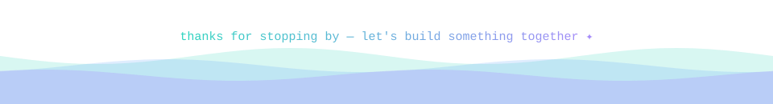

