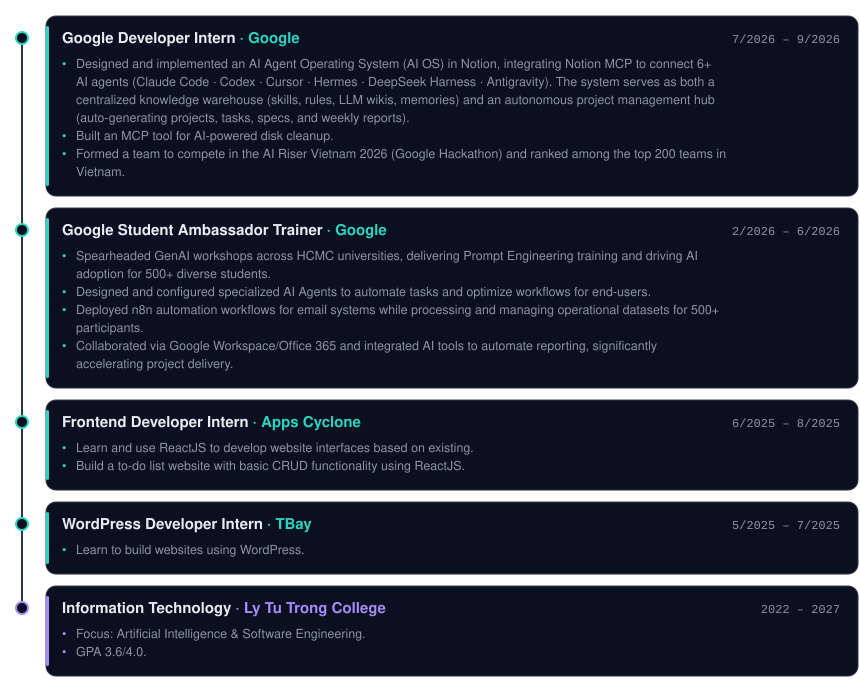

<!-- AUTO-GENERATED by build.py from profile.json + README.tpl.md. Do not edit README.md by hand: edit those two files instead. -->

 

{{@badges}}

  

<table>
  <tr>
    <td valign="top"></td>
    <td valign="top"></td>
  </tr>
</table>

 

<h3 align="center">About</h3>

{{@about}}

 

<h3>Experience &amp; Education</h3>

  

<h3>Skills</h3>

  

<h3>Projects</h3>

{{@projects_grid}}

 

<h3>Repositories</h3>

{{@repos_grid}}

 

<h3>Certificates &amp; Achievements</h3>

{{@highlights}}

 

<h3>Contributions</h3>

{{@trophies}}

 

{{@counter}}

